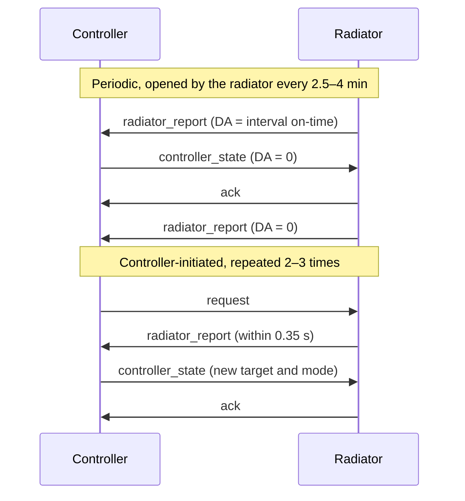
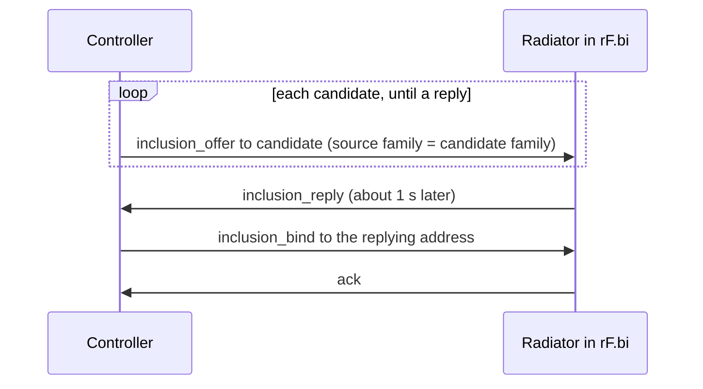

# radiator-rf specification

[Overview](../../README.md) · [Shared values](../common.md) · [clevertouch-upstream](../clevertouch-upstream/specification.md)

The 868 MHz link between a Purmo/LVI Touch E3 controller and its radiators: the
observed profile of a Watts-family protocol. Message names such as
`controller_state` are descriptive, not vendor terms. Evidence labels are
defined in [shared values](../common.md#evidence-labels).

## Physical layer

| Parameter | Value | Evidence |
| --- | --- | --- |
| Centre frequency | 868.3 MHz | Observed |
| Modulation, coding | 2-FSK, PCM, no whitening | Observed: both CRCs validate over the plain bytes |
| Symbol duration | 27 µs, about 37 kbit/s | Strong: best of 25–28 µs in an IQ replay sweep scored by valid frames |
| Deviation | about ±17 kHz (16–18 kHz) | Tentative: measured from IQ |
| Preamble, sync | `AA` bytes, then `D3 91 D3 91` | Observed; preamble length unknown |

Receivers match `AA D3 91 D3 91`. Transmit timing and frequency tolerances are
unknown. 868.0–868.6 MHz is CEPT short-range-device band h1.5
(ERC/REC 70-03 Annex 1): 25 mW e.r.p., with either a duty cycle of at most 1 %
or listen-before-talk with adaptive frequency agility (LBT+AFA). National rules
apply.

## Frame envelope

Offsets count from the length byte, after the sync. `L = frame[0]`.

| Offset | Bytes | Content |
| --- | ---: | --- |
| `0` | 1 | `L`: frame length excluding `L` and the outer CRC |
| `1..4` | 4 | Source address |
| `5` | 1 | Marker `C6` |
| `6..9` | 4 | Destination address |
| `10..L-2` | `L-11` | Payload |
| `L-1..L` | 2 | Inner CRC, little-endian |
| `L+1..L+2` | 2 | Outer CRC, big-endian |

A frame is `L + 3` bytes; the minimum is 14 (`L >= 11`). Trailing receiver bits
after the outer CRC are not part of the frame.

### Checksums

| Property | Inner | Outer |
| --- | --- | --- |
| Algorithm | CRC-16/MODBUS | CRC-16/CMS |
| Polynomial | `0x8005` (reflected `0xA001`) | `0x8005` |
| Initial value | `0xFFFF` | `0xFFFF` |
| RefIn / RefOut | true / true | false / false |
| XorOut | `0x0000` | `0x0000` |
| Covers | bytes `1..L-2` | bytes `0..L` |
| Check on `123456789` | `0x4B37` | `0xAEE7` |

To build a frame: write the header and payload, set `L`, append the inner CRC,
then the outer CRC. Both must pass. They detect errors; they do not
authenticate the sender.

### Addressing

Four bytes, written as eight hex digits. During inclusion the controller
replaces its first source byte with the candidate's (`F1` or `D0`) and keeps the
other three. This suggests a family byte plus a three-byte identity
(**Strong**). Ordinary traffic uses the `F1` family. A radiator kept its address
across deletion and re-inclusion, so the controller learns addresses rather
than assigning them (**Observed**, one radiator).

## Messages

A frame's type follows from its whole payload, never from its addresses or its
length alone. Only these shapes are messages:

| Message | Direction | `L` | Total | Payload |
| --- | --- | ---: | ---: | --- |
| `radiator_report` | radiator → controller | `23` | 38 | Records `DF 4B 8A E1 DA 0A` |
| `controller_state` | controller → radiator | `38` | 59 | Records `45 4B 3B 4C 8E CC 97 94 E1 DA 5B B2` |
| `request` | controller → radiator | `0D` | 16 | `19 00` |
| `ack` | radiator → controller | `0F` | 18 | `01 00 0A 47` |
| `inclusion_offer` | controller → candidate | `0F` | 18 | `00 00 03 01` or `00 00 03 64` |
| `inclusion_reply` | radiator → controller | `0D` | 16 | `00 00` |
| `inclusion_bind` | controller → radiator | `0D` | 16 | `01 00` |

- The two record layouts fill the payload exactly, in this order, with no
  terminator or padding. The other payloads match byte for byte.
- Anything else is `unknown`: a partial, reordered, extended or repeated
  layout, other short values, a lookalike offer. Keep its bytes; assign no
  roles or values.
- Each recognised layout has each tag once.
- Do not infer direction from tag `01`: it opens both `ack` and
  `inclusion_bind`.
- `request` and `ack` carry no sequence number, result or command reference.
  An `ack` is not confirmation.

### Record grammar

An ordinary payload is a sequence of `[tag][value]` records:

```text
value_length = (tag >> 6) + 1     # 01–3F: 1 byte, 40–7F: 2, 80–BF: 3, C0–FF: 4
```

Unknown tags can be skipped by this rule. Tag `00` ends the stream; only zero
bytes may follow. A record that overruns the payload, or a nonzero byte after
`00`, means the payload is not a record stream. Inclusion offers are such
payloads.

## Exchanges

Traffic comes in short exchanges between the controller and one radiator
(**Observed**).



| Exchange | Triggered by |
| --- | --- |
| Periodic | A per-radiator cycle. `controller_state` repeats the radiator's own values with the controller's clock. |
| Controller-initiated | Opening the radiator's menu or changing its mode at the panel; a schedule phase boundary. The next `request` follows 0.2–0.7 s after `controller_state`. |

When no report answered a `request`, the controller still sent
`controller_state`. Retry rules are unknown.

## Records

Multi-byte words are unsigned big-endian.

| Tag | Bytes | In | Content | Evidence |
| --- | ---: | --- | --- | --- |
| `4B` | 2 | report, state | Air temperature; in a state, the controller's echo | Strong: equals upload field `16` |
| `8A` | 3 | report | `[target:u16][mode:u8]`, the active target and mode | Observed |
| `94` | 3 | state | Same layout, the controller's target and mode | Observed |
| `E1` | 4 | report, state | `[00][front max %][duty of rated %][duty of limited %]` | Byte 1 Observed; duty relation Observed; uncalibrated |
| `DA` | 4 | report, state | Two u16 on-times in seconds since the last reset ([power](#power-e1-da)) | Strong; uncalibrated |
| `DF` | 4 | report | Radiator state word | Two bits Strong; rest Unknown |
| `97` | 3 | state | Echo of the answered report's `DF` | Observed for byte 0 and byte 2 bit 0 |
| `5B` | 2 | state | Boost time in minutes | Strong: × 60 equals upload field `14` |
| `B2` | 3 | state | Controller clock: hour, minute, second | Strong |
| `0A` | 1 | report, ack | `47` | Unknown |
| `01` | 1 | ack, bind | `00` | Unknown |
| `19` | 1 | request | `00` | Unknown |
| `45` | 2 | state | `00 00` | Unknown |
| `3B` | 1 | state | `00` | Unknown |
| `4C` | 2 | state | `00 00` | Unknown |
| `8E` | 3 | state | `00 00 84` | Unknown; not the Watts floor-thermostat field |
| `CC` | 4 | state | `00 00 00 00` | Unknown |

The constant values never varied across all modes, Boost, a 55 % power limit, a
rating change, re-pairing, and heating on and off. Tag `5E`, a second
temperature in related Watts decoders, was never seen.

### Temperature and mode (`4B`, `8A`, `94`)

The word is tenths of a degree Fahrenheit ([temperatures](../common.md#temperatures)).
`084C` means unavailable. Decoders report °F exactly (`temperature_F`,
`setpoint_F`) and leave Celsius to the consumer. The mode byte uses the
[shared mode table](../common.md#heating-modes).

- `8A` carries the active mode's target, not a stored Comfort setpoint. Changing
  mode changes it; returning restores the previous value.
- Off carries raw 320 (0 °C).
- Example: `8A 02 A8 00` is Comfort at 20 °C; `94 01 40 01` is Off.

### Power (`E1`, `DA`)

| `E1` byte | Content |
| ---: | --- |
| 0 | `00` |
| 1 | Front-panel maximum power, percent: 100, 70 or 55 (**Observed**) |
| 2 | Duty as a share of rated power, percent |
| 3 | Duty as a share of the limited power, percent |

- Byte 2 ≈ byte 3 × byte 1 / 100, within one unit (**Observed**: 97 of 99
  frames at 55 %, 484 of 484 at 100 %). Neither rounding nor truncation gives
  every value; both probably derive from a finer internal value.
- Both duties describe one heating element (**Strong**). Multi-panel radiators
  were not observed.
- Keep a duty byte above 100 as raw data. Do not clamp it.
- `DA` word 1 counts against duty 1, word 2 against duty 2. They are interval
  counts, not totals.
- After a report with nonzero `DA` is answered by `controller_state`, the
  radiator's next report counts again from zero (**Observed**: 71 of 72 carried
  zero; the other came 1 s later and carried 1 s). Which message resets the
  count, `controller_state` or the `ack` that always follows it, is unknown.
- For duty fraction `d` over time `T` since the previous zero-`DA` report,
  `DA ≈ T·d` (**Strong**: median 0.99 over 36 intervals). Never sum repeated
  reports.

If duty and on-time were calibrated, a single-panel radiator's estimates would
be the following, with `rated_W` from upload field `23`:

```text
power_W     = rated_W * duty_1_pct / 100
interval_Wh = rated_W * on_time_1_s / 3600
```

### State words, Boost time and clock (`DF`, `97`, `5B`, `B2`)

| `DF` byte | Values | Content |
| ---: | --- | --- |
| 0 | `00`, `20` | Constant per radiator; Unknown |
| 1 | `30`, `31` | Bit 0: set in the first report after a change made at the radiator, cleared after the controller's `ack` (**Strong**: 7 of 7 changes, one radiator) |
| 2 | `00`, `01` | Bit 0: the element is heating now (**Strong**: agrees with upload field `33` in 222 of 224 uploads) |
| 3 | `40` | Unknown |

- The heating bit is a sample within the regulation cycle. It is neither the
  duty nor an estimate of it.
- `97` is derived from the `DF` of the report it answers: byte 0 = `DF` byte 0;
  byte 1 = `30`; byte 2 = `04` with bit 0 = `DF` byte 2 bit 0 (**Observed**:
  128 of 128). The meaning of `30` and of the `04` bit is unknown.
- `5B` is held and counted by the controller. Outside Boost it is the next
  Boost's duration; during Boost, the time left. Default 120; observed up to
  1439 (23 h 59 min). A value below the default outside Boost is consistent with
  a countdown that ended otherwise than at the panel. Behaviour at zero is
  unknown.
- `B2` is a binary clock. Accept it only if hour < 24 and minute, second < 60. It
  implies no date, time zone or synchronisation requirement.

## Inclusion

Observed with a previously paired radiator, removed from the controller's
device list and put in its `rF.bi` inclusion mode. A factory-new radiator and a
non-panel controller are untested.



- Candidates swept: `F1 10 00 01`, `D0 00 00 02`, `F1 10 00 03`. These are
  discovery values, not device addresses. The full range and stopping rule are
  unknown.
- `00 00 03 64` replaced `00 00 03 01` in one attempt the panel refused as
  already installed. The byte's meaning is unknown.
- The exchange takes about 3 s, with gaps of about 1 s. Repeated inclusions
  produced identical bytes: no challenge or counter is visible. Replay and a
  foreign controller are untested.
- The radiator replied only after an offer.
- Re-inclusion reset the radiator's stored values: Comfort 19 °C, Frost 7 °C,
  Eco 15.5 °C, upload fields `10` and `11` to 25 °C, Boost time 7200 s. These are
  observed values for one radiator, not universal defaults.
- Panel count and wattage, asked during inclusion, are not part of the RF
  exchange.

## Schedule execution and command delivery

- The Touch E3 runs the weekly schedule (**Observed**). Schedule edits, at the
  panel or through the cloud, sent nothing over RF.
- At each phase boundary, 2–4 s after the quarter-hour by its `B2` clock, the
  controller opens an exchange and sends mode 8 or 11 with the phase's target.
- A replacement controller must therefore run the schedule and keep a clock.
- In the one tested cloud delivery, a mode change reached the radiator at its
  next periodic exchange, 115 s after the panel accepted it. The panel had
  already reported the new mode upstream.
- Which device computes duty, and what a radiator in Program does without its
  controller, are unknown.

## Receiving and sending

A receiver validates both CRCs, recognises only the shapes in
[messages](#messages), decodes the fields above, and keeps any other intact
frame as `unknown`.

### Constructing `controller_state`

No rule produces the Unknown records for a given radiator, and the controller
holds `5B`. So a `controller_state` is built from one the controller sent to
that radiator earlier, and the report it answers:

| Record | Content |
| --- | --- |
| `4B`, `E1` | Copied from the report being answered |
| `94` | New target and mode; Off carries raw 320 |
| `DA` | Zero |
| `97` | Derived from the report's `DF` (above); other bits unchanged |
| `B2` | Controller clock |
| Others | Unchanged from the earlier frame |

This reproduces 119 of 119 recorded controller frames that answer a report
(**Observed**).

### Confirmation

Confirm a command by a later `radiator_report` carrying the new mode and target.
A valid CRC or an `ack` is not confirmation. A report can show the target one
raw unit (1/18 °C) below the value sent (11 of 250 cases).

## Open questions

- Acceptance of a controller other than the radiator's own panel.
- Transmit timing and frequency tolerances; retry rules.
- Radiator behaviour when the controller falls silent.
- Where duty is computed; calibration of `E1` and `DA`; which message resets `DA`.
- The Unknown records and bits; the inclusion candidate range.

## Synthetic frame examples

Invented addresses: controller `F1010203`, radiator `F1040506`. Discovery
candidate `F1100001` is a protocol value. These test parsing and encoding, not
radio acceptance. [vectors.json](vectors.json) holds these and further cases:
decoded fields, `unknown` frames, and frames to reject, each breaking one check.
Vectors at the observed frame lengths were cross-checked with an independent
decoder.

| Message | Frame from the length byte | Bytes |
| --- | --- | ---: |
| `radiator_report` | `23F1040506C6F1010203DF203000404B02A88A02BA00E100641919DA000A000A0A47CD48C59D` | 38 |
| `controller_state` | `38F1010203C6F10405064500004B02A83B004C00008E000084CC00000000972030049402BA00E100641919DA000000005B0078B20C0000A20F60D9` | 59 |
| `request` | `0DF1010203C6F10405061900A01B4377` | 16 |
| `ack` | `0FF1040506C6F101020301000A47E6E64D5A` | 18 |
| `inclusion_offer` | `0FF1010203C6F1100001000003011FF3EA1F` | 18 |
| `inclusion_reply` | `0DF1040506C6F1010203000080E1D2A1` | 16 |
| `inclusion_bind` | `0DF1010203C6F10405060100AA1B1F72` | 16 |
